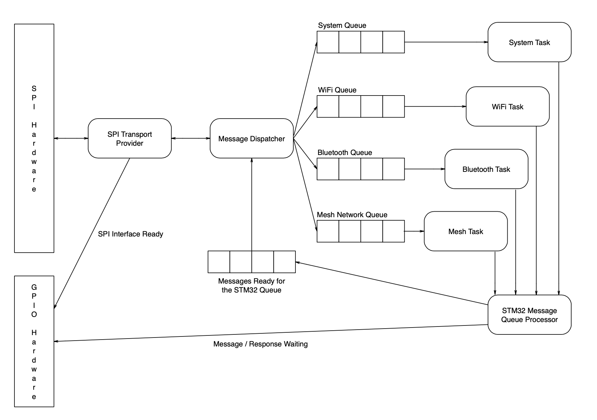

# Communications Overview

The MeadowComms application is a FreeRTOS application using ESP-IDF 4.2.  The application is designed to use the SPI bus and two GPIO lines to send the requests to the following services:

* WiFi
* Bluetooth
* Mesh Networking
* System (e.g. configuration) requests

## STM32 and ESP32 Communication

The STM32 and ESP32 communication using two interfaces, SPI for message exchange and GPIO of status signalling:

The SPI interface is bidirectional with requests being generated by the STM32 application and libraries and responses and status messages generated by the ESP32.

The STM32 acts as a SPI controller and the ESP32 acts as a SPI peripheral device.

The _ESP32 SPI Interface Ready_ is used by the ESP32 to indicate that the interface has completed set up and is ready to receive a message from the STM32.  This signal allows for the fact that the ESP32 takes a small amount of time between the ESP starting to setup the SPI interface and the interface being ready to receive a message.  Although small it can lead to data misalignment resulting in some data being lost.

The _Message / Response Waiting_ interrupt indicates that the ESP32 has completed a task and has information for the STM32.  This signal is required as the STM32 is the SPI controller device.  This prevents the ESP32 from being able to arbitrarily send a message to the STM32.  The responses must be requested by the STM32.

## STM32 SPI Communication and Message Processing

The STM32 deals with requests from Mono and Meadow.Core using through a number of tasks and message queues.

A .NET application can make a direct request to the ESP32 for activities such as starting the WiFi network, scanning for a list of access points / networks etc.  These requests are processed by the _UPD_ layer.  This layer passes the requests through to the underlying request processing layer.

The second way an application can make a request to the ESP32 is through the Mono runtime system.  This maybe through calling a .NET API such as the `Socket.Connect` method.

Both of these methods use the same underlying system to hold and send messages to the ESP32:

Any request starting with either UPD or Mono will generate a [message](MessageFormat.md).  A request can be blocking or non-blocking.

The message is first added to an outbound message queue.  The type of request is then examined.  For a non-blocking request the system simply returns from the request and the application can then continue.

For a blocking request, the message holding the request is placed in a linked list of messages waiting for responses.  The system then creates a semaphore and takes the semaphore.  This effectively prevents the application from continuing on the current thread until the response returns.

Messages are then picked up by the _Message Queue Task_.

The system has the capability of sending up to 16K of data per message.  Any large messages must take into consideration the fact that the ESP32 can only send and receive up to 4090 bytes in a single SPI transfer.  In order to achieve this any large messages are broken down into smaller messages and then reassembled as needed.

### Message Queue Task

The Message Queue Task monitors the outbound message queue and waits until there one or more messages are waiting to be processed.  When a message arrives, the task hands the message over to the message dispatcher which then deals with the process of sending the message, processing the handshaking and any message responses.

Sending a message is a multistage process:

1. Send message header and the initial data packet if there is any data to send
2. Receive header acknowledgement / negative acknowledgement
3. Send any further data packets (for large messages)
4. Receive header and payload acknowledgement / negative acknowledgement
5. Repeat from 3 until all of the data associated with the message has been sent.

The full communication process is described in detail in the [SPI Protocol Overview](SPIProtocolOverview.md) page.

## ESP32 SPI Communication and Message Processing

The ESP32 uses FreeRTOS as its operating system.  The combination of FreeRTOS and ESP-IDF allows the creation of a multithreaded system (FreeRTOS) capable of accessing the hardware on the ESP32 (through ESP-IDF).

Pictorially, the system looks as follows:

At startup, the application on the ESP32 starts a task to handle the SPI data packet transfer.  The SPI task has a single responsibility, to transfer data between the two systems and to pass on valid messages to the _Message Dispatcher_.  Invalid messages (CRC failures etc.) are dealt with transparently to the remainder of the system.

The _Message Dispatcher_ takes the incoming message and uses the _Interface_ parameter to determine which of the various systems (WiFi, Bluetooth etc.) the message is destined for. It then places the message into the message queue assigned to the specific subsystem.

The _Message Dispatcher_ also contains a message queue for responses or messages / interrupts destined for the STM32.

## Anatomy of a Subsystem

Each of the subsystems on the ESP32 is responsible for processing the requests from the STM32 and where necessary generating responses for the STM32.

Each system is constructed with knowledge of the _Message Dispatcher_ and the hardware it can interact with.  The system comprises of a message queue taking incoming requests and a task that monitors the message queue for requests.  The task waits on the message queue until a request is received and then processes the request.  If a response is generated it is then added to a queue of messages waiting to be sent to the STM32.

## Sending Data or Responses to the STM32

As noted earlier, the STM32 is the communication system controller.  This means that the ESP32 cannot initiate communication, it can only respond to requests from the STM32.  A GPIO signal is used to indicate to the STM32 that the ESP32 has data available for the STM32.  The STM32 monitors this GPIO line and an interrupt is generated on a transition from high to low.  The STM32 interrupt handler will add a _Send Response_ message to the message queue.  This will be picked up by the _Message Queue Task_ as normal.

### _Send Response_ Message

The _Send Response_ message is a special message for the both the STM32 and the ESP32.

For the STM32 it indicates that the message should be sent to the ESP32 (to request the response) and the STM32 then enters the process of requesting the response message from the ESP32.

It is possible that noise may have generated the interrupt.  In this case the initial response to the request for data (from the STM32 to the ESP32) will generate a message indicating that there are no responses available.  In this case the request is ignored on both sides.

In the case of a valid response, the STM32 will request the data from the ESP32 and then process it accordingly.  The responses fall into one of three categories:

* Response to a request
* Interrupts messages

#### Message Response

When the STM32 receives a response to say a `Socket.Connect` request, it will use the _MessageId_ field in the header and the linked list (for blocking messages discussed above) to identify the message that generated the request.  The response will be attached to the original request and a post to the semaphore with then release the originating thread to run once again.

#### Interrupts

The STM32 uses a separate interrupt table for each of the ESP32 subsystems.  The STM uses the _Interface_ property of the message along with the _Function_ property to identify which interrupt has been generated.  The appropriate C method is called on the STM32 if a match is found.

See the [Interrupt Overview](SupportFiles/InterruptProcessing.md) for more information on how to set this up.
