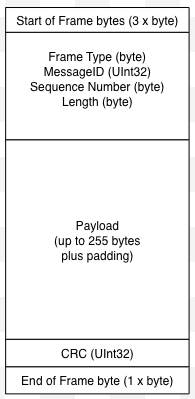

# Frame Format

Large messages are broken down into one or more frames.  Frames allow the detection of errors on a smaller number of bytes than if the detection is performed on the full payload.

As with messages, frames have header and payload information.  Additionally, a frame contains a CRC for error detection:

Frames are made up of the following:

* Frame type
* Message ID
* Sequence number
* Payload length
* Payload
* CRC

Frames are surrounded by two elements:

* Start of frame bytes
* End of frame byte

## Start of Frame Bytes

The start of a frame is indicated by a repeated sequence of bytes.  This implementation sends three 0xAA bytes to indicate the start of a frame.

The initial state of the system is to look for the sequence of three 0xAA bytes as a start of frame.  All bytes up to the first three 0xAA bytes will be ignored.  Once these bytes have been received the system will start to process the frame moving through the header information through to the _End of Frame_ byte.

The sequence of three 0xAA bytes used as a marker means that this sequence should not appear in the rest of the frame.  To overcome this limitation (as three 0xAA bytes is a legitimate sequence in the header, payload and CRC) a padding character is used.

### Padding

A padding character (in this case 0x52) is used to overcome the restriction that three 0xAA bytes will be used as a _Start of Frame_ marker.

If three 0xAA bytes occur in the frame then the bytes will be replaced by the sequence 0xAA, 0xAA, 0x52, 0xAA.  In this case, the 0x52 will be discarded leaving only the three 0xAA bytes as desired.  Note that this will need to be repeated for longer sequences of 0xAA bytes.

This also raises the complication that the sequence 0xAA, 0xAA, 0x52 would cause the 0x52 byte to be discarded.  In this case, the sequence will be replaced by 0xAA, 0xAA, 0x52, 0x52.

## End of Frame Byte

A single end byte (0x55) is sent after the last byte of the frame.

## Frame Type

Two _Frame Type_s are currently supported:

* Transport Frames
* Application Data Frames

Transport Frames are used to send information between the sender and receiver interfaces.  Messages of this type include:

* ACK
* NAK
* Reset
* Resend

The frame type is a single unsigned byte.

## Message ID

This is the _Message ID_ from the message.

The message ID is a 32-bit unsigned integer.

## Sequence Number

A _Sequence Number_ allows the determination of the location of the frames payload in the message payload.

## Length

The _Length_ field indicates the amount of data in the payload after any padding (see above) has been removed.

The _Length_ should be the same for all frames except the last one.  The current implementation uses a frame length of 255 bytes.

## Payload

The payload contains up to 255 bytes of data (when padding has been removed).

## CRC

A 32-bit CRC is used to detect errors in the frame.  The CRC is calculated on the original data frame excluding the following:

* Start of frame bytes
* Padding characters
* End of frame byte

The CRC allows for error detection but not error correction.