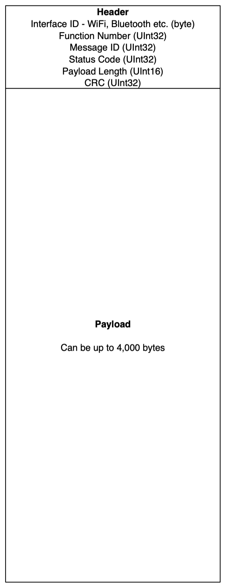

# Message Format

A message is made up of two parts:

* Message Header
* Payload

Messages allow bidirectional communication between the STM32 and the ESP32.  The payload part of the messages can therefore contain a request (from the STM32 to the ESP32) and a response (from the ESP32 to the STM32).

## Message Header

The message header contains enough information to allow the ESP32 to route the request to the correct interface and also ensure that the ESP32 can allocate enough space for the message to be processed.

The fields in the message header are:

* Interface ID
* Function
* Message ID
* Status code
* Payload length
* CRC

### Interface ID

The interface ID indicates which interface should process the message.  The following interfaces are available:

* WiFi
* Bluetooth
* Mesh network
* System

The interface is an 8-bit unsigned value.

### Function

The function bytes indicate the type of request being made to the receiver.

This is a 32-bit unsigned integer.

### Message ID

The Message ID field should be unique for each interface.  The presence of this field allows the sender to match any responses to the original request.  In this was the sender and receiver can be implemented as multi-threaded systems.

The message ID field is a 32-bit unsigned integer.  This allows for over 4 billion messages and this will wrap around to 0.

### Status Code

The status code indicates the success or failure of the ESP32 system / message processing system.  This is not the same as the result of a method call (for instance `sendto`).  This can indicate the result of the request to start the network or the ability of the system to 

### Payload Length

The payload length indicates the number of bytes in the message payload.  This is the number of bytes in the final message.  As we shall see later, the number of bytes used to send the payload may be more than the number of bytes in the payload due to the error checking requirements.

The payload length is indicated by a 16-bit unsigned integer.  The maximum length of a payload is limited to 4,000 bytes.  This limitation is derived from the hardware restriction in the SPI implementation on the ESP32.

### CRC

Each message sent has a 32-bit CRC value.  This is filled with 0 when the CRC is calculated and thn populated with the 32-bit value before the message is sent.

## Message Payload

The message payload is a sequence of bytes that the interface will require in order to process the request.
