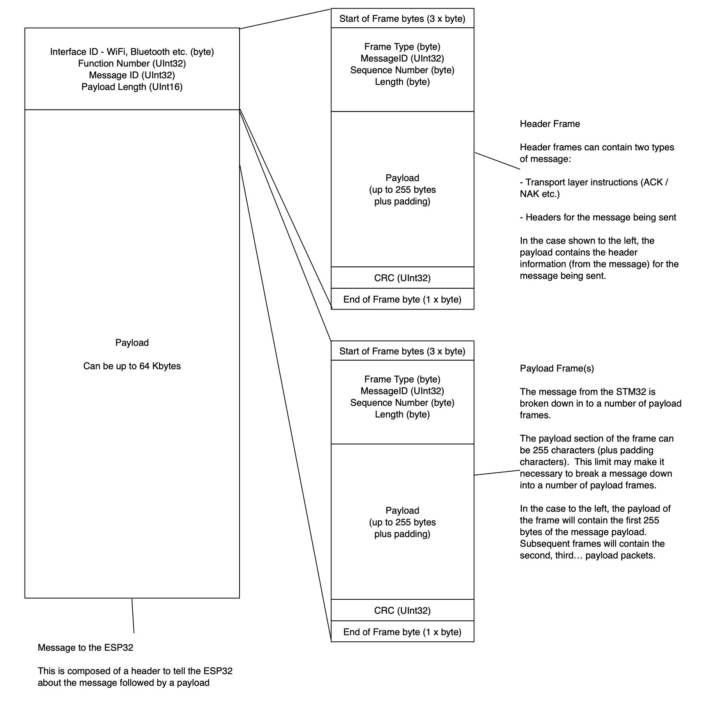

# Messages and Frames

The high level unit of data transmission between the STM32 and the ESP32 is the message.  Messages are used to send instructions and responses of varying sizes between the two devices.

Messages are broken down into frames of data.  Frames are the smallest communication unit that can be sent between the two devices.

A message can be made up of one or more frames.  It is the responsibility of the sender to break a large message down into frames and send these using the UART.  The receiver is responsible for validating the frames and reassembling them into the original message.

The following diagram shows the relationship between messages and frames:

## Success / Errors (ACK / NAK)

The receiver is also responsible for checking the validity of the frames and sending a success (ACK) or failure (NAK) message back to the sender.

On receiving an ACK response the sender shall send the next packet or an End of Message packet.

On receiving a NAK response the sender shall either resend the frame or inform the receiver to reset / discard the current message.

The format and meaning of _Messages_ and _Frames_ are broken discussed in the following pages:

* [Message Format](MessageFormat.md)
* [Frame Format](FrameFormat.md)
