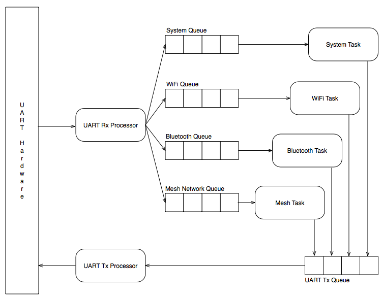

# Overview

The MeadowComms application is a FreeRTOS application using ESP-IDF 3.1.  The application is designed to listen to the UART and then send the requests to the following services:

* WiFi
* Bluetooth
* Mesh Networking
* System (configuration) requests

## UART Communication

Communication between the STM32 and the ESP32 is achieved using the UART.  Further information on the implementation can be found in the following pages:

* [Message Format](MessageFormat.md)
* [Frame Format](FrameFormat.md)
* UART Rx Processor States - TBC
* UART Tx Processor States - TBC

## Tools

The project is a Visual Studio solution using the [VisualGDB plugin from SysProgs](https://sysprogs.com/).  This is a $99 plugin (Embedded only level required) for Visual Studio.  It allows quick and easy implementation of ESP32 projects including integrated debugging.

## Current Status

### UART Communication - WIP

Basic comms has been completed.

Error detection is largely implemented although there are some edge cases that need to be taken into consideration.

Payload reassembly

ACK / NAK needs to be completed.

Test application in C# is currently being worked upon (adding new cases).

### WiFi - WIP

Queues have been implemented.

### Bluetooth

Queues have been implemented, all messages will then be deleted as the Bluetooth functionality is not currently implemented.

### Mesh Networking

Queues have been implemented, all messages will then be deleted as the Mesh Networking functionality is not currently implemented.

### System Requests

Queues have been implemented, all messages will then be deleted as the System Requests functionality is not currently implemented.

This functionality may be best served by being directly implemented in the _UART Rx Processor_.