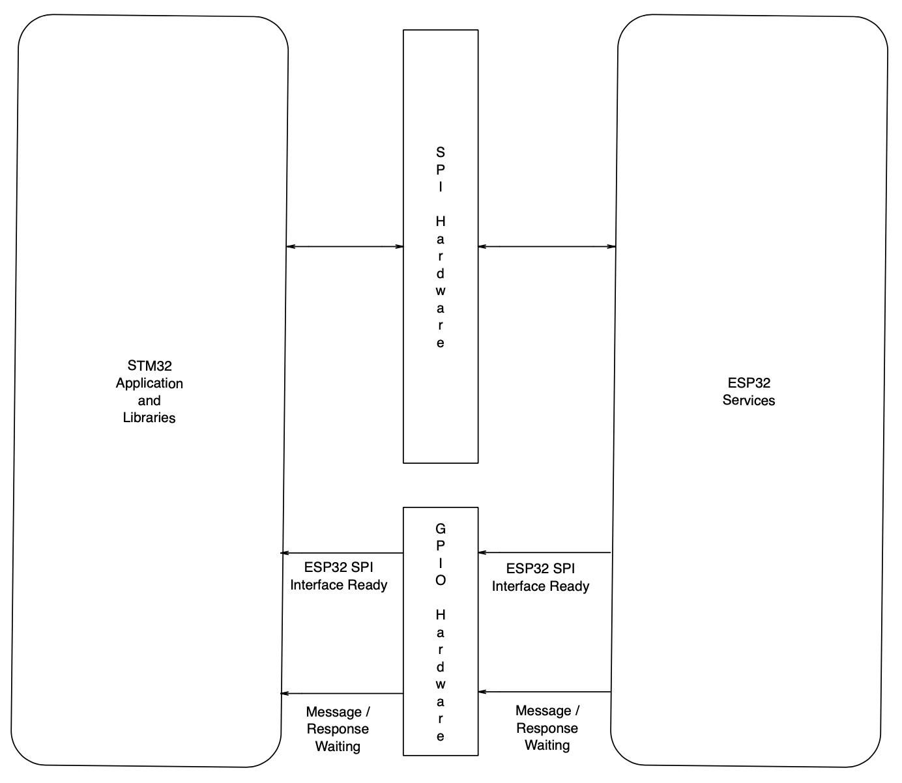
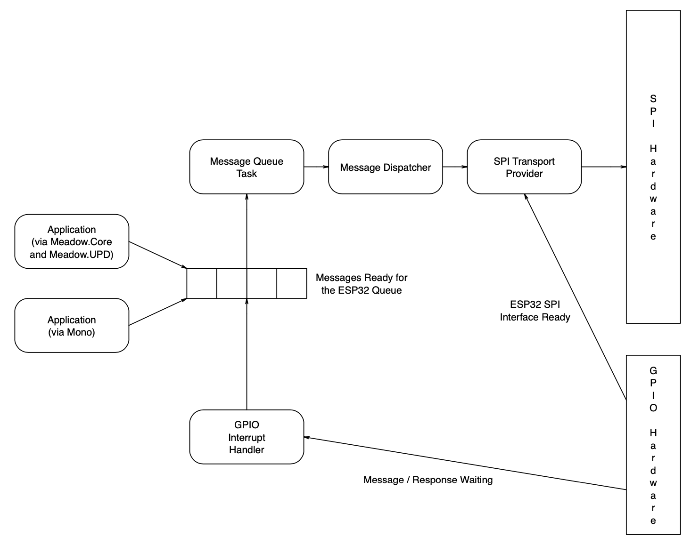
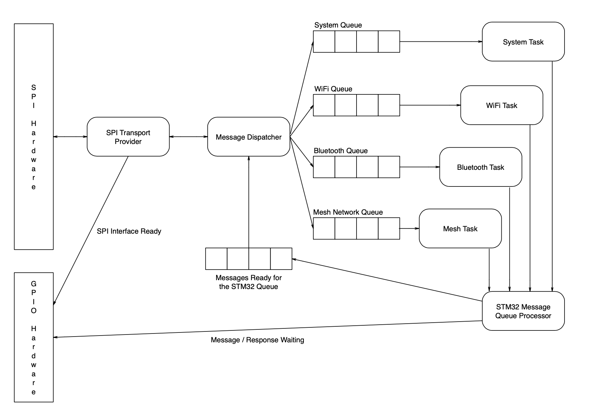

# Overview

The MeadowComms application is a FreeRTOS application using ESP-IDF 4.1.  The application is designed to use the SPI bus and two GPIO lines to send the requests to the following services:

* WiFi
* Bluetooth
* Mesh Networking
* System (configuration) requests

## STM32 and ESP32 Communication

The STM32 and ESP32 communication using two interfaces, SPI for message exchange and GPIO of status signalling:

The SPI interface is bidirectional with requests being generated by the STM32 application and libraries and responses and status messages generated by the ESP32.

The STM32 acts as a SPI controller and the ESP32 acts as a SPI peripheral device.

The _ESP32 SPI Interface Ready_ is used by the ESP32 to indicate that the interface has completed set up and is ready to receive a message from the STM32.  This singal allows for the fact that the ESP32 takes a small amount of time to receive a message, process it and then setup the SPI interface for message reception.

The _Message / Response Waiting_ interrupt indicates that the ESP32 has completed a task and has information for the STM32.  This signal is requested as the STM32 is the SPI controller device.  This prevents the ESP32 from being able to arbitrarily send a message to the STM32.  The responses must be requested by the STM32. 

## STM32 SPI Communication and Message Processing

The STM32 deals with requests from Mono and Meadow.Core using through a number of tasks and message queues.

A .NET application can make a direct request to the ESP32 for activities such as starting the WiFi network, scanning for a list of access oints / networks etc.  These requests are processed by the _UPD_ layer.  This layer passes the requests through to the underlying request processing layer.

The second way an application can make a request to the ESP32 is through the Mono runtime system.  This maybe through calling a .NET API such as the `Socket.Connect` method.

Both of these methods use the same underlying system to hold and send messages to the ESP32:

Any request starting with either UPD or Mono will generate a [message](MessageFormat.md).  A request can be blocking or non-blocking.

The message is first added to an outbound message queue.  The type of request is then examined.  For a non-blocking request the system simply returns from the request and the application can then continue.

For a blocking request, the message holding the request is placed in a list of messages waiting for responses.  The system then creates a semaphore and takes the semaphore.  This effectively prevents the application from continuing on the current thread until the response returns.

### Message Queue Task

The Message Queue Task monitors the outbound message queue and waits until there is one or more messages waiting to be processed.  When a message arrives is hands the message over to the message dispatcher which then deals with the process of sending the message, processing the handshaking and any message responses.

## ESP32 SPI Communication and Message Processing

